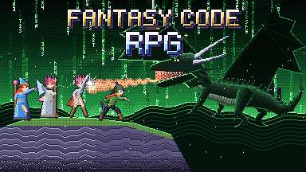
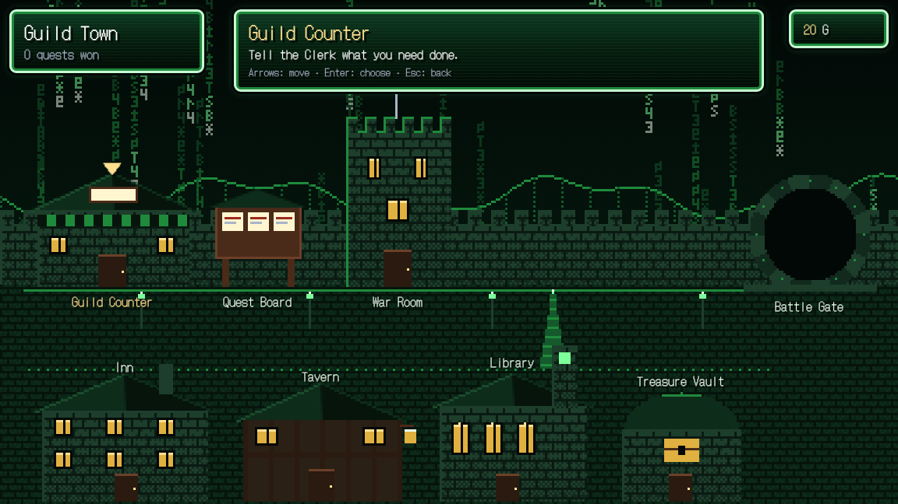
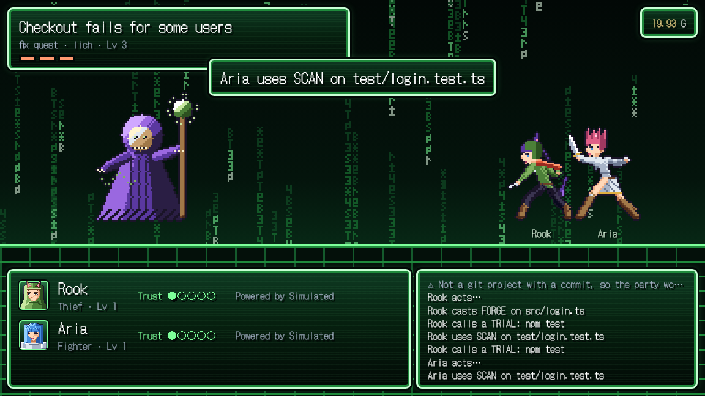

# Fantasy Code RPG



**A 90s-RPG harness for AI agent teams. Agents earn autonomy by proving they're reliable.**

The game is *Fantasy Code RPG*; its command is `fcrpg`.

```
╔═ PARTY ══════════════════════════════════════════════════════╗
║ Aria       Lv 7 T1 Fighter      REL 0.74 claude-code         ║
║   EXP ████░░░░░░░░ 545/1660                                  ║
║   may: read, write                                           ║
║ Bram       Lv 6 T0 Novice       REL 0.39 codex               ║
║   may: read                                                  ║
║ Cass       Lv 4 T1 Cleric       REL 0.81 anthropic-api       ║
║                                                              ║
║ 💰 Treasury: 97.97 G                                         ║
╚══════════════════════════════════════════════════════════════╝
```

You recruit AI agents (Claude Code, Codex, Gemini CLI, any API model) into a party.
Tasks are enemies. Acceptance criteria are their HP. Every agent starts as a **Novice** that can only read and suggest.
Win battles reliably and you're **promoted**: first you may write files, then run tests, then open PRs, then lead a party yourself.
Get sloppy and you're **cursed** back down a tier.

Under the 16-bit paint, Fantasy Code RPG is a **progressive-trust permission system**: autonomy is earned from a measured track record, and the harness, not the prompt, enforces it.

## Try it in 10 seconds

```bash
npx fantasy-code-rpg demo     # Node ≥ 22.18, zero runtime dependencies
```

Or install the `fcrpg` command:

```bash
npm install -g fantasy-code-rpg
fcrpg demo
```

The demo runs 40 simulated battles. One fighter is reliable, one is sloppy, and a cleric judges them. Watch who gets promoted.

## See it in your browser

```bash
fcrpg play --demo             # a practice guild with simulated heroes; open the link it prints
```

Walk around Guild Town, ask the Clerk for a quest, plan it in the War Room, send the party out, and keep or undo the result at the Treasure Vault. English and Japanese.




## Play for real

```bash
cd your-project
fcrpg init
fcrpg recruit Aria --adapter claude-code --job fighter --mp 200 --refill 5
fcrpg recruit Cass --adapter anthropic-api --job cleric --billing api
fcrpg fund 5                                  # 5 G = $5 of API budget
fcrpg lore "We use pnpm. Never edit /legacy."

fcrpg request "Login crashes when the email field is empty"   # the Clerk writes the quest
fcrpg import github --label bug  # or bring in open GitHub issues as quests
fcrpg plan q1                 # War Room: read-only scouting report and plan (automatic in Story mode)
fcrpg battle q1

# Or write a quest by hand:
fcrpg spawn bug-42 --name "Login crashes on empty email" --kind goblin --level 3 \
  --criteria "fix: empty email shows a validation error" \
  --criteria "test: a regression test covers it" \
  --check "test=pnpm test -- login" --guard "pnpm test"

fcrpg suggest bug-42          # the recommended party, with reasons
fcrpg battle bug-42           # no --party: the Council picks the lead; swap anyone with --party
fcrpg keep <battle-id>        # Treasure Vault: bring the changes into your project
fcrpg undo <battle-id>        # …or throw them away (counts as a loss for the party)
fcrpg council                 # how each Council seat has decided, and how often it was right
fcrpg asks                    # heroes paused, asking your permission (or answer in the browser)
fcrpg seer <hero>             # seat a cheap, fast hero as the Council's Seer
```

Every battle runs in **its own copy of your project** (a git worktree), with a save point after each hero's turn. Nothing touches your folder until you choose Keep.

## The world in one table

| Game | Reality |
|---|---|
| Character | An agent: one model behind one CLI or API |
| Job class | Role: ⚔️ Fighter (build) · 🔮 Mage (design) · ✚ Cleric (review/test) · 🗡️ Thief (debug) · 🎵 Bard (docs) |
| Tier T0→T4 | Permissions: read → write → run commands → network/PRs → merge/recruit |
| Enemy / HP | A task / its acceptance criteria |
| XP | Work done, weighted by correctness, quality, cost and speed |
| REL | Wilson lower bound of success rate. Drives promotion. Luck can't fake it |
| Gold / MP | API dollars / subscription CLI quota that refills at the Inn |
| The Chronicle | Shared context every CLI and API character reads and writes |
| Save point | A commit after every hero's turn, in the battle's own copy of the project |
| Quest type | Build · Fix · Improve · Explore · Maintain · Write: sets the party, budget and what counts as proof |
| The Council | How every decision is made: rules → win records → a cheap fast model → a vote across AI companies → you |

Design plan: **[docs/DESIGN_PLAN.md](docs/DESIGN_PLAN.md)** · Decisions: **[docs/DECISIONS.md](docs/DECISIONS.md)** · Full rules: **[docs/WORLD.md](docs/WORLD.md)** · How it is built: **[docs/ARCHITECTURE.md](docs/ARCHITECTURE.md)** · Lessons from other projects: **[docs/CROSS_REFERENCE.md](docs/CROSS_REFERENCE.md)** · The 90s feel: **[docs/EXPERIENCE.md](docs/EXPERIENCE.md)** · UX plan: **[docs/UX_PLAN.md](docs/UX_PLAN.md)**

## Three rules that make this more than a skin

1. **No self-grading.** A character never judges its own battle. Tests, CI, another character, or a human do.
2. **Permissions are enforced by adapters**, through each CLI's own sandbox and tool-allowlist flags. A prompt saying "please don't" isn't a permission system.
3. **Trust is per job.** A great Fighter isn't automatically a trustworthy Cleric.

## Status

**v0.2 in progress.** Playable core (rules, Chronicle, battle loop, judge, Gatekeeper, 7 adapters, terminal UI) plus the Guild Counter (the Clerk writes quests), the War Room (scout and plan), play styles, quest types, the Council's first two seats, fair cross-company judging, recommended parties, and battles in private copies with save points, Keep and Undo; one Gatekeeper enforced across Claude Code, Codex and Gemini CLI, a "no proof, no victory" stop hook, GitHub Issues import, and the launch scenes in the browser (`fcrpg play`). Wait mode (heroes may ask for one rank above their own, verified on a real Claude Code install); the Seer, lessons and house rules in the Chronicle, and suggestions that learn from your picks. Pincer (two approaches, the better one wins) and Siege (a quest split into parts fought at once, then joined) formations; the Council flags risky quests and watches for stuck battles. 66 tests.
CLI flag mappings for Claude Code / Codex / Gemini CLI are marked `VERIFY` and need community testing.

## Join the guild

This is built in the open and needs heroes. See **[ROADMAP.md](ROADMAP.md)** for quests sized from 🟢 Slime (first PR) to 🐲 Dragon, and **[CONTRIBUTING.md](CONTRIBUTING.md)** for how to claim one.

Wanted most: CLI adapter testers, a pixel-art web UI, an MCP server for the Chronicle, and game designers to balance the numbers.

## License

MIT

## Design a hero or a monster

Every task in the game is a monster, and the best ones come from folklore whose legend matches a real coding problem: a Hydra is a bug that keeps coming back. Heroes, races, outfits and monsters are all open for design. Read the [art guide](docs/ART_GUIDE.md), then open a **🧝 Hero design** or **👾 Enemy design** issue. Sketches and words are enough.

## Status and safety

This is an **alpha**. Claude Code support has been tested on a real install (2.1.309). Codex and Gemini CLI support follows their documented hook systems but hasn't been tested on real installs yet; until it is, keep those heroes at low ranks. Heroes work in private git copies of your project, and nothing reaches your folder until you choose Keep, but start in a project you can afford to break. See [SECURITY.md](SECURITY.md).

## Credits

- Pixel font: [DotGothic16](https://github.com/fontworks-fonts/DotGothic16) by the DotGothic16 Project Authors, under the SIL Open Font License 1.1 (bundled in `src/web/fonts/` with its licence).
- Every sprite, portrait and backdrop is original, drawn by the code in `assets/generators/`.
- The game nods to the 16-bit RPGs that inspired it; it isn't affiliated with or endorsed by their makers.

## Licence

MIT. See [LICENSE](LICENSE).
