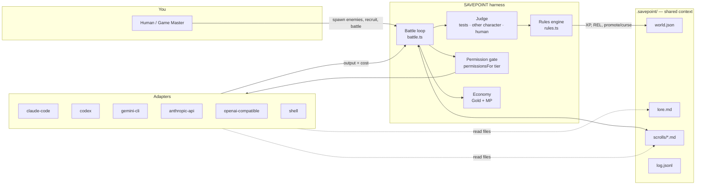

# Architecture

## Shape of the system

## Modules

| File | Responsibility | I/O? |
|---|---|---|
| `src/types.ts` | All shapes. JSON-serializable only. | no |
| `src/rules.ts` | Every number in WORLD.md: tiers, XP, REL, promotion, curses. | no — pure |
| `src/economy.ts` | Gold treasury, MP refill windows. | no — pure |
| `src/store.ts` | `.savepoint/` files: world state + the Chronicle. | files |
| `src/adapters/*` | Turn "character + permissions + prompt" into a process or HTTP call. | processes, network |
| `src/gate.ts` | The Gatekeeper: classifies each tool call against the character's tier; read-only shell commands count as reading. | no — pure |
| `src/quests.ts` | The six quest types and their defaults; the Law's keyword classifier. | no — pure |
| `src/council.ts` | The Council: decision cascade (Law → Ledger → Seer → Trial → You), decision records and outcomes, Thompson-sampling maths. | `chronicle/decisions.jsonl`, `outcomes.jsonl` |
| `src/ledger.ts` | Win records per quest type × hero, from battle reports. | no — pure |
| `src/hooks.ts` | One rulebook for three CLIs: tool-name translation, reply formats, the "no proof, no victory" stop gate, hook settings for Claude Code, Codex and Gemini CLI. | checks run on stop |
| `src/importers.ts` | GitHub Issues → quests through `gh`. | `gh` |
| `src/play.ts` | The browser game's server: 127.0.0.1 + one-time key, secret-free state snapshot, live events over SSE, every in-game command through the engine's own functions (serialized; one battle at a time). | http |
| `src/web/` | The browser game: `i18n.js` (English/Japanese), `ui.js` (stage, rain, API, events, sprites, menus), `town.js` (Guild Town painted from state), `scenes.js` (Title, Town, Counter, Board, War Room, Vault, Tavern, Inn, Library, Settings), `battle.js`. No framework, no build step. | browser |
| `src/asks.ts` | Wait mode: questions from paused heroes as atomic files in `chronicle/asks/`, answered from the browser or the CLI; no answer in time means no. | files |
| `src/roster.ts` | Recruiting heroes (shared by the CLI and the browser). | no |
| `src/stages.ts` | Guild Counter (the Clerk), War Room (Scout, Planner), play-style settings. Desk jobs run read-only. | via adapters |
| `src/party.ts` | Recommended party and plain-language warnings; the lead is a Council decision. | via council |
| `src/instance.ts` | A git worktree per battle (one per approach in a Pincer, one per part in a Siege), save point commits, joining Siege parts, Keep (merge) and Undo (discard). | git |
| `src/battle.ts` | Instance → turns with save points (Relay, Pincer or Siege) → judge → rewards → Treasure Vault → Debrief. | via the above |
| `src/render.ts` | Terminal windows and bars. | no |
| `src/cli.ts` | Commands. | stdout |

Keep `rules.ts` and `economy.ts` pure. Balance changes should be one-file PRs with a test.

## How CLIs and APIs share context

The Chronicle is just files in `.savepoint/chronicle/`. That's deliberate:

- **CLI characters** (Claude Code, Codex, Gemini CLI) already have file tools, so they can read `lore.md` and the quest scroll directly. The prompt also embeds both.
- **API characters** have no file access, so the battle loop embeds the same lore and scroll in their prompt.
- After every turn, the character's output is appended to the quest's scroll. The next character, whatever it runs on, sees it.

A Mage on the API can write a plan, a Fighter on Claude Code can implement it, and a Cleric on Gemini can review it, all through one scroll.

**Next step:** expose the Chronicle as an MCP server so CLIs can query and write lore mid-battle instead of only at turn boundaries. AgentFlow's `get_pipeline_context` / `set_pipeline_context` tools are a good reference design.

## How tiers are enforced

`permissionsFor(tier)` produces a `Permissions` object. Each adapter translates it into the strongest control its backend offers:

| Adapter | Mechanism |
|---|---|
| claude-code | **Gatekeeper hook** (`src/gate.ts`) checks every tool call via Claude Code's `PreToolUse` hook. Battle heroes get `--allowedTools` for one rank above their own with `--permission-mode dontAsk`, so the hook can ask you; desk jobs run in `plan` mode and never ask. Verified on Claude Code 2.1.309 |
| codex | `--sandbox read-only` / `workspace-write` (+ network config at T3), plus the same Gatekeeper through Codex hooks (`-c hooks.PreToolUse`, `hooks.Stop`) |
| gemini-cli | `--approval-mode` default / auto_edit / yolo, `--sandbox` once exec is allowed, plus the same Gatekeeper through Gemini hooks (`BeforeTool`, `AfterAgent`) |
| anthropic-api, openai-compatible | Text only — they can't act on the world at any tier yet |
| shell | `minTier: 2`; the battle refuses to start below it |

Adapters report `violation` when they catch overreach. That's a critical failure: three failed trials against REL.

Known weakness: Codex's sandbox doesn't separate "write" from "exec", so a T1 Codex character can run commands. Documented in the adapter; better mappings welcome.

## Instances and save points

Each battle gets a git worktree on branch `savepoint/<battle-id>`, created from your current `HEAD` in `~/.cache/savepoint/instances/<repo>-<hash>/` (override with `SAVEPOINT_INSTANCES`). Heroes, checks and the guard all run there. After every hero's turn the instance commits a save point. At the end:

- **critical failure** → the instance is discarded at once;
- **no changes** → discarded, nothing to review;
- otherwise → `review: "pending"` until you run `savepoint keep <id>` (fast-forward or merge into your branch; refuses rather than overwrite your uncommitted work) or `savepoint undo <id>` (discard; an undone victory counts as a loss).

Folders that aren't git repositories with a commit fall back to running in place, with a warning. `--in-place` forces that.

## The Council

`Council.decide(kind, question, seats, questId)` asks the seats in order. A seat returns `{answer, confidence, reasons}` or `null`. The first answer at or above the bar for that kind wins; otherwise the decision goes to you with the most confident answer as a suggestion. Every decision is appended to `chronicle/decisions.jsonl`; `markOutcome()` appends right/wrong to `outcomes.jsonl` (latest mark wins), and `accuracy()` reports each seat's record. Seats are plain functions, so adding the Seer (a cheap model) or the Trial (cross-company vote) is adding a function, not changing the cascade.

## Judging

The current judge (in `battle.ts`): run every check first; then `chooseJudges()` picks up to three judges, one per AI company before doubling up, never anyone who fought. `anonymize()` hides names, ids, adapters and models from the evidence (scroll + diff). Each judge sees the conditions in a rotated order and returns a verdict per condition; each condition is a `proof` decision for the Council that needs a unanimous vote, and a split goes to you. Conditions with `proof: "human"` are left for the Treasure Vault, where Keep confirms them.

The original description, kept for history:

1. **Checks** — each criterion can carry a shell command; exit 0 means met.
2. **A judge character** — for criteria without checks. Must not be in the fighting party (enforced).
3. **Guard** — an optional regression command (e.g. full test suite). Failing it = critical.

Self-reported `DONE:` lines are claims only. Nothing is credited without a check or a judge.

## Decisions log

- **Zero runtime dependencies.** Node ≥ 22.18 runs `.ts` directly via type stripping. Contributors clone and run, no build step.
- **Files, not a database,** for v0. Humans and agents can both read the state. SQLite can come later behind `Store`.
- **Wilson lower bound for REL,** so a 3-for-3 lucky streak can't out-trust a 58-for-60 veteran.
- **Build on, don't fork.** See below.
- The full, dated decision log is **[DECISIONS.md](DECISIONS.md)**.

## Prior art and what to build on

We surveyed existing open-source projects (October 2026). None combine reliability-gated permissions with a game layer, but several solve pieces we shouldn't rebuild.

| Project | License | What it gives us | How we'd use it |
|---|---|---|---|
| [Claw Orchestrator](https://github.com/Enderfga/claw-orchestrator) | MIT, TS, Node 22 | One interface over Claude Code, Codex, Antigravity, Cursor Agent, OpenCode, custom CLIs; JSONL cost ledger; runtime-enforced `maxBudgetUsd`; MCP server; separates engine self-report from runtime verification | Strongest candidate for a **runtime adapter**: wrap its `SessionManager` as one SAVEPOINT adapter and inherit all its engines and cost tracking |
| [ORCH](https://github.com/oxgeneral/ORCH) | MIT, TS | Task state machine with mandatory review gate, inter-agent messaging, shared context store, git worktree isolation, TUI | Alternative runtime adapter; also a reference for worktrees and messaging |
| [AgentFlow](https://github.com/harun-yardimci/agentflow) | Apache-2.0, TS | SQLite-backed shared pipeline context exposed as MCP tools | Reference design for the Chronicle MCP server |
| [LiteLLM proxy](https://docs.litellm.ai/docs/proxy/users) | MIT (core) | Per-key budgets with reset windows, rate limits, spend tracking across 100+ providers | Give each API character its own virtual key → real **Gold** enforcement outside our process |
| [kaits](https://github.com/projectious-work/kaits) | MIT, Python | Closest concept: RPG roles, levels, XP, per-agent autonomy modes, budget caps | Idea source, not a code base (different stack, no CLI agents) |
| [Guild Hall](https://github.com/XusBadia/guild-hall) | MIT | RPG dashboard visuals (archived) | Inspiration for the web UI |
| [vibe-kanban](https://github.com/BloopAI/vibe-kanban) | check repo | Popular board for Claude Code / Codex / Gemini tasks | UX reference for the quest board |

**Strategy:** SAVEPOINT owns the *game and trust layer* (rules, judge, permissions, Chronicle) and stays thin. Execution runtimes are pluggable adapters. Our built-in CLI adapters keep it working standalone; a `claw` or `orch` adapter lets power users bring a heavier runtime.
