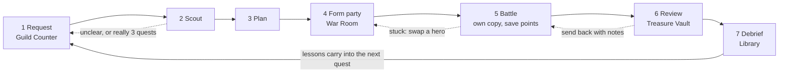
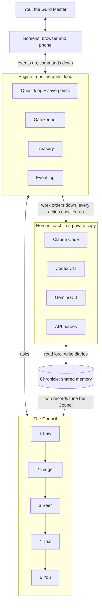

# Fantasy Code RPG — Game Design Plan

> Every task runs the same seven-stage quest loop, and every stage gets its own scene. The game's map is the work's map.
>
> This file is the repo copy of the living design doc. Decisions and their history are in [DECISIONS.md](DECISIONS.md). Status markers: ✅ built · 🔨 next · ⏳ later.

## 1. The quest loop

You decide at Request (what "done" means), Plan, and Review. In Story mode, only at Review.

| Stage | Scene | What really happens | Why it improves the result | Status |
|---|---|---|---|---|
| 1 Request | Guild Counter | The Clerk restates the goal, proposes victory conditions each with a proof (command, judge or you), sets a budget, flags anything unclear | Most failed tasks were never defined | ✅ `savepoint request`: the Clerk writes conditions with proofs; unsafe checks are refused; questions block the road |
| 2 Scout | Scouts' Lodge | Read-only recon: map files, reproduce the bug, pull related lore | Catches wrong diagnoses and hidden extra work cheaply | ✅ in `savepoint plan`; loops back when unclear or really several quests |
| 3 Plan | War Room | Steps, files, test strategy, risks, cost; big quests split | Plans are checked in seconds; bad code takes hours | ✅ `savepoint plan`, `approve`; the plan goes to the party |
| 4 Form party | War Room | Recommended lead, supports, judge, formation, tactics; swap anyone | Puts each AI on work it has a record at; keeps the judge independent | ✅ recommendation + warnings, lead chosen by the Council |
| 5 Battle | Battlefield | Heroes work in a private copy; a save point after each turn | Nothing breaks your project; any step can be undone | ✅ instances + save points |
| 6 Review | Treasure Vault | Proof per condition, cross-company judge, Keep / Undo | Evidence, not claims | ✅ Keep / Undo, fair cross-company vote per condition, your conditions settled at Keep, Pincer side-by-side |
| 7 Debrief | Library | Lessons to the Chronicle; outcomes marked on every Council decision | How the guild adapts to you | ✅ Council outcomes · 🔨 lessons |

## 2. Quest types

Defined in `src/quests.ts`.

| Type | Example | Monsters | Formation | Proof of victory | Lead needs |
|---|---|---|---|---|---|
| Build | "Add sign-in with Google" | Chimera, Golem | Relay | New tests pass + a demo | change files |
| Fix | "Checkout fails for some users" | Hydra, Wisp, Kitsune, Phoenix | Relay, reproduce first | A failing test now passes; old tests pass | change files |
| Improve | "Make the dashboard faster" | Kasa-obake, Ouroboros | Solo + judge | Old tests pass; the number improved | change files |
| Explore | "Which payment provider?" | Sphinx | Scout only | A sourced report you accept | read |
| Maintain | "Update the libraries" | Slime | Solo, Frugal; can repeat on a schedule | Checks pass | run commands |
| Write | "Update the setup guide" | Book Mimic | Bard leads, a second hero follows the steps | The steps work | change files |

## 3. Parties

- **Roles:** Lead (main work; must be trusted for what the quest needs), Support, Scout (read-only; how Novices earn trust), Judge (never the worker; preferably another company). Max 4.
- **Formations:** Solo · Relay (default) · Pincer (✅ built: two approaches in two copies, checks then an order-swapped cross-company vote; ~2×) · Siege (✅ built: the quest split into up to four parts, each fought at once in its own copy, then joined; a part that clashes is set aside for the next battle). All must fit the quest's one budget.
- **Tactics:** Careful · Balanced (default) · Bold · Frugal.
- **Recommendation:** can they do it → have they won this kind before (the Ledger) → available → independent judge → cost. Your swaps teach it (✅).

## 4. RPG systems → real features

| RPG system | What it really is | Where |
|---|---|---|
| Rank | How much a hero may do without asking | Guild Hall |
| Equipment | Tools: connectors, browsers, skills; better gear needs rank | Armory |
| Spells | Saved playbooks that won before | Spellbook |
| Items | Hint Scroll, Ether (top up MP with Gold), Smoke Bomb (retreat to save point), Phoenix Feather (retry from a save point with another hero) | Item menu |
| Save points | Commits after each turn in the battle's own copy | Battlefield |
| Dungeon instance | A git worktree per battle | Automatic |
| MP / Gold | Subscription quota / pay-per-use spend | Inn, Treasury |
| Status ailments | Waiting, rate-limited, overspending, looping, off-goal | Status |
| Kingdoms / regions | Projects / folders | World Map |
| Patrols | Scheduled recurring quests | Quest Board |
| Messenger | Letters to your phone when needed | Mailbox |
| Badges | Project safety setup that raises the autonomy cap | Guild Hall |
| Chronicle | Shared memory for every AI | Library |

## 5. Play styles

| Style | You do | Guild handles |
|---|---|---|
| Story | Describe; judge the result | Everything else |
| Adventurer | Approve conditions and plan; accept or swap the party | Scouting, formation, tactics |
| Tactician | Everything is editable | Nothing hidden |

New players start in Story; after three quests the game offers Adventurer (sooner if they open plans). Gatekeeper prompts and Review always reach you.

## 6. Scenes

20 scenes; 11 in the launch slice.

| Scene | Stage | Main commands | Phase |
|---|---|---|---|
| Title | — | Continue (recap), New Game, Settings | Launch |
| Guild Town | Hub | Move; buildings glow when something waits | Launch |
| Guild Counter | Request | New quest, Answer the Clerk, Approve conditions, Import issues | Launch |
| Quest Board | Queue | Pick, Reorder, Patrols, Retire | Launch |
| War Room | Scout, Plan, Party | Scouting report, Approve plan, Accept party, Swap, Formation, Tactics, Depart | Launch |
| Battlefield | Battle | Watch, Tactics, Item, Swap, Pause, Retreat | Launch |
| Decision (Wait mode) | Battle | Allow once, Deny, Hand to another hero, Answer | Launch |
| Treasure Vault | Review | See proof, Verdict, See changes, Keep, Second opinion, Send back, Undo | Launch |
| Library | Debrief | Recap, Lessons, House rules, Quest diaries | Launch |
| Tavern | Setup | Recruit (connect an AI), Appearance, Rename, Dismiss | Launch |
| Inn | Economy | MP, Rest timers, Wake early with Gold | Launch |
| Scouts' Lodge | Scout | Reports, Send scouts | Next |
| Treasury | Economy | Budgets, Ledger, Alerts | Next |
| Armory | Equipment | Equip tools per hero, Loadouts | Next |
| Guild Hall | Trust | Ranks, Promotion trials, Trust record, Badges, Spellbook, Council chamber | Next |
| Training Grounds | Trust | Practice quests, Promotion trials | Next |
| Bestiary | Debrief | Monster lore, Who wins against what | Next |
| Mailbox | Away | Letters, Answer from your phone | Next |
| World Map | Explore | Kingdoms, Regions, Fog | Later |
| Atelier | Art | Approve generated art | Later |

**Field menu (Esc):** Party · Quests · Items · Spells · Tactics · Chronicle · Settings · Save.

**Guild Town:** a walled citadel at night under falling green code. The main street follows the loop: Guild Counter at the gate → Quest Board plaza → War Room in the keep → Battle Gate (a ring of runes; each active battle is a pillar of light beyond it) → Treasure Vault → Library. Side streets: Tavern and Inn; Armory and Training Grounds; Treasury by the keep; Guild Hall on the hill; Atelier tower. A building glows green when something waits there; locked buildings are wireframe outlines with their unlock condition; the rain speeds up when many heroes work.

**First run:** New Game (name, language, play style) → Clerk welcome → Tavern: connect your first AI (installed CLIs detected first) → suggested second hero from another company as judge → Training Grounds practice quest → first real quest → unlocks shown.

## 7. How it all fits together

## 8. The Council

Every decision is answered by the cheapest seat that is sure enough, written to `chronicle/decisions.jsonl`, and marked right or wrong by the Debrief (`outcomes.jsonl`). Code: `src/council.ts`. `savepoint council` prints each seat's record.

| Seat | Decides | Cost | Passes up when | Status |
|---|---|---|---|---|
| 1 Law | Risky actions, budget, loops, "it has a test: run it", quest type by keywords, lead when only one hero qualifies | Free | No rule applies | ✅ quest type, lead · 🔨 loop detection |
| 2 Ledger | Lead by win record per quest type × hero (Thompson sampling) | Free | Too little data, or no clear best | ✅ |
| 3 Seer | Quest type, clarity, risk, stuck; asked 3×, unanimous only | < 1 s, fractions of a cent (estimate) | Answers disagree, or under the bar | ✅ quest type (any hero you seat) · 🔨 risk, stuck; outside services |
| 4 Trial | Proof of victory; which of two solutions. Run checks first; then up to 3 judges from different companies, authors hidden, order rotated, unanimous vote per condition | Seconds–minutes, ~3¢ (estimate) | Split, tests vs judges | ✅ proof vote · ✅ comparing two solutions (Pincer) |
| 5 You | Irreversible actions, splits, unclear requests | Your time | — | ✅ (suggestion shown) |

Bars: 0.95 for hard-to-undo decisions, 0.85 otherwise; recalibrated weekly from outcomes (batch jobs at half price). A decision type moves to a cheaper seat after ~50 correct cases (our rule of thumb). Prompts share a fixed cached prefix (5–10% of input price at Anthropic, OpenAI and Google).

**Research behind it:** agreement across samples beats self-reported confidence (Xiong et al., arXiv 2306.13063); majority voting delivers most of debate's gains (Choi, Zhu, Li, arXiv 2508.17536); same-model sampling beats mixed models for generation (Self-MoA, arXiv 2502.00674) while judges favour their own writing (Panickssery et al., arXiv 2404.13076); running code beats judging it (CodeT, arXiv 2207.10397; S*, arXiv 2502.14382); cascades cut cost up to 98% (FrugalGPT, arXiv 2305.05176); simple routers are hard to beat (LLMRouterBench, arXiv 2601.07206); ask humans only when several answers remain plausible (KnowNo, arXiv 2307.01928); handing up with a clean brief beats handing up the whole history (The Handoff Tax, arXiv 2608.24358).

## 9. Allies

Outside tools are optional adapters, earn their seat on our own records, and fail by passing the question up.

| Ally | Decides | Seat | Use |
|---|---|---|---|
| Jev (TypeSafe AI) | Typed choice / score / yes-no with confidence | Seer | Optional; copy LiteLLM's timeout + fallback; early access; sends text to TypeSafe |
| Arch-Router 1.5B | Named routes such as quest type, ~50 ms locally | Seer | Optional after licence check |
| LiteLLM auto routing | Model size for API heroes, Thompson sampling per tier | Ledger, Seer | Optional backend (beta) |
| Not Diamond | Model + thinking effort per agent step | Seer | Watch (waitlist) |
| OpenRouter Auto | Model by popularity | — | Not used as a decider |
| Selene Mini, Prometheus 2 | Rubric scoring for non-code work | Trial | Optional, Apache-2.0 |
| Small thinking models (Qwen3-8B class) | Code pairs when tests can't decide | Trial | Optional |
| MCP sampling + elicitation | Company-neutral "cheap/fast/smart" requests; multiple-choice questions to you | Seer, You | Adopt |
| DGP | Evidence → typed decision → receipt format | All | Borrow the shape |

**Workflow allies:** fair judging (authors hidden, order shuffled, per-condition scores) · "no proof, no victory" gate via `Stop` / `TaskCompleted` hooks · one rulebook compiled into Claude Code, Codex and Gemini CLI hooks (Codex can't "ask" yet: deny and call you) · clean-brief escalation · AGENTS.md generated from the Chronicle · Chronicle as an MCP server · Agent Client Protocol adapter · PAL MCP consults · ccusage + OpenTelemetry GenAI-shaped log · sandbox-runtime around battles · spec-style Request/Plan files (Spec Kit, Kiro).

**Watch-outs:** subscription logins (official CLI only, never its tokens) · licences (AGPL / Commons Clause: ideas only; Arch-Router and Glider pending) · churn (keep services behind adapters) · untrusted text (web pages and repo files are data, never instructions).

## 10. Build order

1. ✅ **Quest record upgrade.** Quest types, proof per condition, default budgets, "needs".
2. ✅ **Instances and save points.** Worktree per battle, commit per turn, Keep / Undo. ✅ One rulebook enforced through hooks in Claude Code, Codex and Gemini CLI.
3. ✅ **Clerk, Scout and Plan steps.** `request`, `answer`, `plan`, `approve`, play styles (`settings`). ✅ `import github`. ✅ The Seer (`savepoint seer <hero>`) confirms quest types with three unanimous votes.
4. ✅ **Party recommendation** through the Council (Law + Ledger). ✅ Learning from the leads you pick.
5. ✅ **Battle event stream** and the first browser screen: `savepoint play` shows the live battle (moves, save points, damage, verdict), the party, the Quest Board (Q) and the Treasure Vault (V) with Keep / Undo / Approve. `--demo` stages a simulated party.
6. ✅ **Treasure Vault** fair cross-company vote; conditions only you can judge settled at Keep. ✅ "No proof, no victory" stop hook in all three CLIs.
7. ✅ **Debrief**: lessons into the lore after every battle; your undo reasons become house rules.
8. ✅ **Launch scenes in the browser**: Title, Guild Town, Guild Counter, Quest Board, War Room, Battlefield, Treasure Vault, Tavern, Inn, Library and Settings, in English and Japanese. ✅ The Decision window: a hero reaching one rank above its own pauses and asks (allow once / deny / hand to another hero), from any scene or the command line.
9. ✅ **Pincer formation**: two approaches in two copies at once; checks decide first, then an order-swapped cross-company vote; a split keeps both for you.
10. ✅ **Real install check, Claude Code** (2.1.309): a novice asks to write → you allow → victory; you deny → retreat, not a loss; a Tier 1 hero writes without asking. Fixes from this run: heroes ask for one rank up only, desk jobs never ask, read-only commands count as reading, no free judge means you decide, lessons stay about the project. Codex and Gemini CLI still need the same check on real installs.
11. ✅ **Siege**: the Scout suggests parts (each covering some victory conditions) or you set them with `savepoint split`; each hero takes a part, all at once, each in their own copy; the parts are joined in order, and one that clashes is set aside. Each hero answers only for their own part, and the stop gate only holds them to their part's checks. A split quest is fought as a Siege by default. Verified with two real Claude Code heroes.
12. ✅ **Risk and "stuck" decisions through the Council.** Risk: after the plan, the Law reads the quest for costly words (database changes, deleting, money, security, secrets, production, rewriting history) and remembers quests that beat a party before; the Seer settles unclear cases, and unsure counts as risky. A risky quest waits for your nod in every play style and the War Room suggests a Pincer. Stuck: between Relay turns the Law reads progress (files changed, checks newly passing), idle turns and the budget; the Seer settles unclear cases; when nobody is sure, the party carries on. The calls are carry on, retreat, or call a stronger hero who takes the next turn. When every condition is proven by a check and all pass, the rest of the party stands down; heroes who never got a turn share neither reward nor blame.
13. **Public release**: trademark check for "Fantasy Code RPG", licence review, contributor guide, tagged release.
